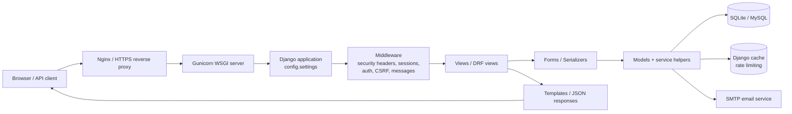
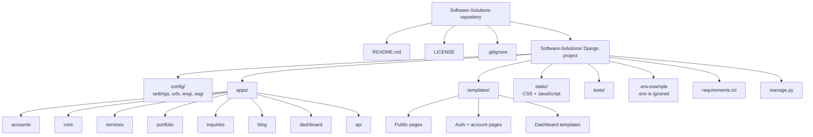
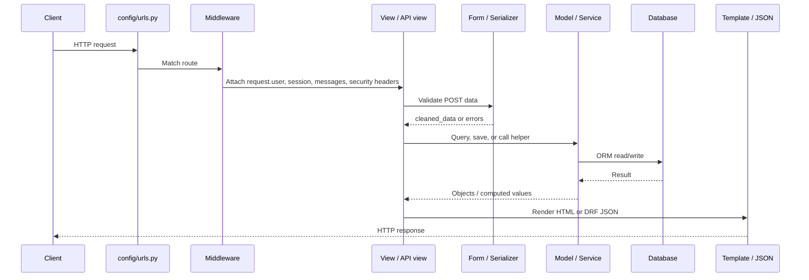
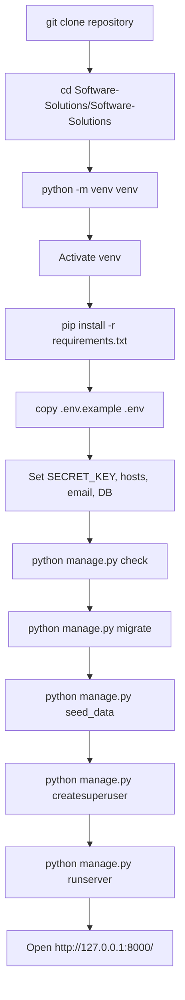
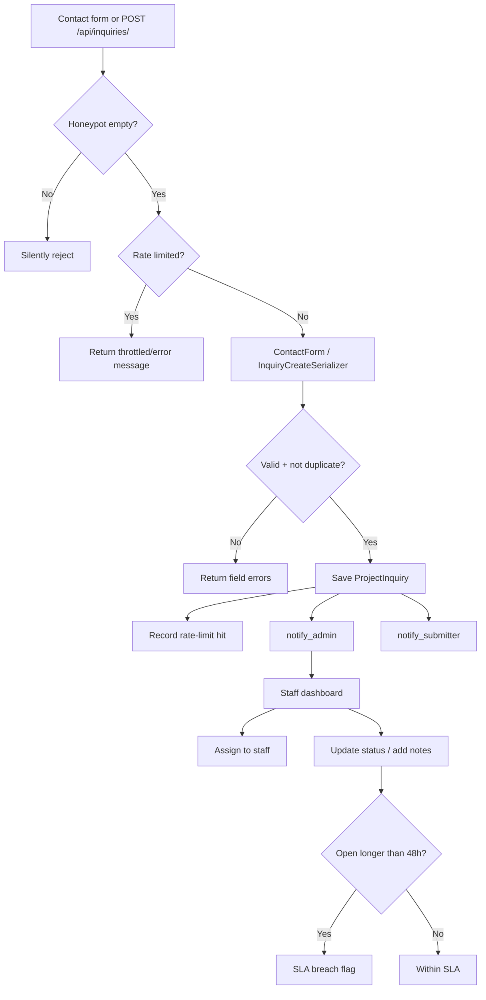
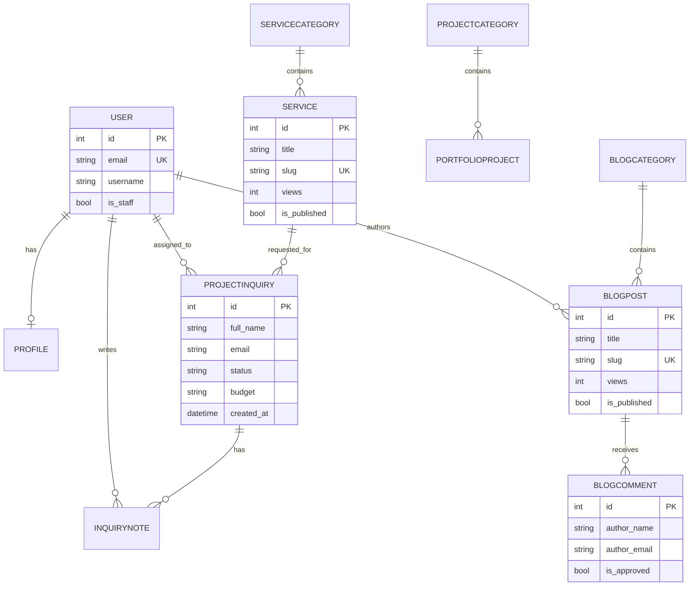

# BALATECH Software Solutions

Production-oriented Django website for BALATECH cloud, web, database, API, and custom software development services. The repository is organized so multiple projects can be added later; this Django application lives in the nested [`Software-Solutions/`](Software-Solutions/) folder.

## Contents

| Section | What it covers |
| --- | --- |
| [Project summary](#project-summary) | Stack, capabilities, and design constraints |
| [Diagrams](#diagrams) | Architecture, structure, request flow, setup, lifecycle, and ERD |
| [Repository structure](#repository-structure) | Folder-by-folder layout |
| [Requirements](#requirements) | Python, packages, and external tools |
| [Environment variables](#environment-variables) | Configuration reference |
| [Database connection](#database-connection) | SQLite and MySQL setup |
| [Install workflow](#install-workflow) | Commands from clone to running server |
| [Backend process structure](#backend-process-structure) | Request flow and command map |
| [Routes](#routes) | Public, authenticated, API, and monitoring endpoints |
| [Testing and quality](#testing-and-quality) | Verification commands |
| [Production notes](#production-notes) | Deployment checklist |
| [License](#license) | MIT |

## Project summary

| Item | Value |
| --- | --- |
| Application | BALATECH marketing site, blog, portfolio, inquiry system, and admin dashboard |
| Framework | Django `5.2.19`, Django REST Framework `3.18.3` |
| Language / runtime | Python `3.12+` |
| Frontend | Server-rendered templates, custom CSS, vanilla JavaScript (no Bootstrap) |
| Database | SQLite by default, MySQL-ready via environment configuration |
| API docs | Swagger UI at `/api/docs/`, OpenAPI schema at `/api/schema/` |
| Auth | Custom email-based user model, sessions, and DRF token authentication |
| Admin | Django Admin plus a custom staff dashboard at `/dashboard/` |
| Tests | `57` passing Django tests |

### Main capabilities

| Area | Included |
| --- | --- |
| Public site | Home, about, services, portfolio, blog, contact, global search, FAQ accordion, newsletter |
| Lead handling | Validated contact form, duplicate prevention, rate limiting, honeypot, admin + submitter emails |
| Content | Services, projects, categories, blog posts, testimonials, technologies, statistics |
| Dashboard | CRUD, inquiry pipeline, assignment, SLA flags, CSV exports, trend chart, view analytics, comment moderation |
| API | Public read endpoints, protected inquiry management, token auth, filtering, search, pagination |
| SEO | Meta tags, JSON-LD, `robots.txt`, dynamic `sitemap.xml` |
| Security | CSRF, staff permissions, security headers, env-based secrets, no committed `.env` |

## Diagrams

GitHub renders the Mermaid diagrams below natively.

### 1. High-level architecture



### 2. Repository structure flow



### 3. Backend request-handling flow



### 4. Install and run workflow



### 5. Inquiry lifecycle



### 6. Data model relationships



## Repository structure

```text
Software-Solutions/                  # GitHub repository root
├── README.md                        # This file
├── LICENSE                          # MIT license
├── .gitignore                       # Repository-wide ignore rules
└── Software-Solutions/              # Django project folder
    ├── manage.py                    # Django management entry point
    ├── requirements.txt             # Pinned Python dependencies (UTF-8)
    ├── .env.example                 # Copy to .env and fill in locally
    ├── .env                         # Local secrets — never committed
    ├── db.sqlite3                   # Local SQLite database — never committed
    ├── config/                      # Project settings and root URL configuration
    │   ├── settings.py              # Env-driven settings, apps, middleware, DRF, email, DB
    │   ├── urls.py                  # Root routes, admin branding, API docs, error handlers
    │   ├── wsgi.py                  # WSGI deployment entry point
    │   └── asgi.py                  # ASGI deployment entry point
    ├── apps/                        # Feature applications
    │   ├── accounts/                # Custom user, profile, login/register/password reset
    │   ├── core/                    # Home/about/search, FAQ, newsletter, SEO, health, middleware
    │   ├── services/                # Service categories and services
    │   ├── portfolio/               # Project categories and portfolio projects
    │   ├── inquiries/               # Inquiry form, notes, email/rate-limit services, CSV
    │   ├── blog/                    # Categories, posts, moderated comments
    │   ├── dashboard/               # Staff-only management console
    │   └── api/                     # REST API serializers, views, URLs
    ├── templates/                   # Public, auth, email, and dashboard templates
    ├── static/                      # Custom CSS and JavaScript
    ├── tests/                       # Smoke and feature test suite
    ├── media/                       # Uploaded files in local development
    └── docs/                        # Reserved for future documentation
```

### Application responsibilities

| App | Models / files | Responsibility |
| --- | --- | --- |
| `accounts` | `User`, `Profile` | Custom email-capable user, account pages, password reset |
| `core` | `SiteConfiguration`, `Statistic`, `Technology`, `Testimonial`, `FAQ`, `NewsletterSubscriber` | Shared site content, search, SEO, health check, security headers |
| `services` | `ServiceCategory`, `Service` | Service catalog and detail pages with view tracking |
| `portfolio` | `ProjectCategory`, `PortfolioProject` | Project showcase with view tracking |
| `inquiries` | `ProjectInquiry`, `InquiryNote` | Lead capture, assignment, SLA, rate limiting, email workflow |
| `blog` | `BlogCategory`, `BlogPost`, `BlogComment` | Articles, categories, and moderated reader comments |
| `dashboard` | Views, forms, URLs | Staff-only CRUD, moderation, analytics, exports |
| `api` | Serializers, viewsets, URLs | Public reads, protected inquiry endpoints, token auth |

## Requirements

### Runtime

| Requirement | Version / note |
| --- | --- |
| Python | `3.12` or newer (tested with `3.12.10`) |
| pip | Latest recommended |
| Django | `5.2.19` (pinned) |
| Database | SQLite included with Python; MySQL `8+` optional |
| Node/npm | Not required (custom CSS and vanilla JS only) |

### Pinned packages

From `Software-Solutions/requirements.txt`:

| Package | Version | Purpose |
| --- | --- | --- |
| `asgiref` | `3.13.0` | ASGI support |
| `attrs` | `26.1.0` | DRF/spectacular dependency |
| `Django` | `5.2.19` | Web framework |
| `django-filter` | `26.2` | API filtering |
| `djangorestframework` | `3.18.3` | REST API |
| `drf-spectacular` | `0.30.0` | OpenAPI schema and Swagger UI |
| `inflection` | `0.5.1` | Schema generation helper |
| `jsonschema` | `4.26.0` | Schema validation |
| `jsonschema-specifications` | `2025.9.1` | JSON Schema specs |
| `pillow` | `13.0.0` | Image field validation |
| `python-dotenv` | `1.2.4` | `.env` loading |
| `PyYAML` | `6.0.4` | YAML schema rendering |
| `referencing` | `0.37.0` | JSON Schema helpers |
| `rpds-py` | `2026.9.1` | Rust-backed schema helper |
| `sqlparse` | `0.6.1` | SQL formatting utility |
| `typing_extensions` | `4.16.0` | Typing backports |
| `tzdata` | `2026.6` | Timezone data |
| `uritemplate` | `4.2.0` | OpenAPI link templates |

> MySQL users must also install `mysqlclient`; it is intentionally not pinned because it needs platform-specific system libraries.

## Environment variables

Copy `Software-Solutions/.env.example` to `Software-Solutions/.env`. The `.env` file is gitignored.

| Variable | Default | Description |
| --- | --- | --- |
| `DEBUG` | `True` | Development debug mode; set `False` in production |
| `SECRET_KEY` | required | Django secret key; generate a long random value |
| `ALLOWED_HOSTS` | `localhost,127.0.0.1` | Comma-separated hostnames |
| `DB_ENGINE` | `sqlite` | `sqlite` or `mysql` |
| `DB_NAME` | `balatech` | MySQL database name |
| `DB_USER` | `balatech` | MySQL user |
| `DB_PASSWORD` | empty | MySQL password |
| `DB_HOST` | `localhost` | MySQL host |
| `DB_PORT` | `3306` | MySQL port |
| `EMAIL_BACKEND` | console backend | Use SMTP backend in production |
| `EMAIL_HOST` | `smtp.example.com` | SMTP server |
| `EMAIL_PORT` | `587` | SMTP port |
| `EMAIL_HOST_USER` | empty | SMTP username |
| `EMAIL_HOST_PASSWORD` | empty | SMTP password |
| `EMAIL_USE_TLS` | `True` | Enable STARTTLS |
| `DEFAULT_FROM_EMAIL` | `no-reply@...` | From address |
| `CONTACT_EMAIL` | `hello@...` | Admin notification recipient |

Generate a secret key:

```powershell
.\venv\Scripts\python.exe -c "from django.core.management.utils import get_random_secret_key; print(get_random_secret_key())"
```

## Database connection

### SQLite (default)

| Setting | Value |
| --- | --- |
| Engine | `django.db.backends.sqlite3` |
| File | `Software-Solutions/db.sqlite3` |
| Setup | Automatic on first `migrate` |
| `.env` | `DB_ENGINE=sqlite` |

### MySQL (optional)

1. Install the driver and platform libraries:

```powershell
pip install mysqlclient
```

2. Create the database and user:

```sql
CREATE DATABASE balatech CHARACTER SET utf8mb4 COLLATE utf8mb4_unicode_ci;
CREATE USER 'balatech'@'localhost' IDENTIFIED BY 'choose-a-strong-password';
GRANT ALL PRIVILEGES ON balatech.* TO 'balatech'@'localhost';
FLUSH PRIVILEGES;
```

3. Set `.env`:

```dotenv
DB_ENGINE=mysql
DB_NAME=balatech
DB_USER=balatech
DB_PASSWORD=choose-a-strong-password
DB_HOST=localhost
DB_PORT=3306
```

4. Apply migrations:

```powershell
.\venv\Scripts\python.exe manage.py migrate
```

## Install workflow

All commands below are run from the nested project folder: `Software-Solutions/Software-Solutions/`.

| Step | PowerShell command | Result |
| --- | --- | --- |
| 1. Clone | `git clone https://github.com/Njbalamani/Software-Solutions.git` | Creates the repository folder |
| 2. Enter project | `cd Software-Solutions\Software-Solutions` | Moves into the Django project |
| 3. Create venv | `python -m venv venv` | Creates an isolated environment |
| 4. Activate venv | `.\venv\Scripts\Activate.ps1` | Activates Python environment |
| 5. Install packages | `pip install -r requirements.txt` | Installs pinned dependencies |
| 6. Configure env | `copy .env.example .env` | Creates local settings file |
| 7. Edit env | `notepad .env` | Add secret key, hosts, email/DB settings |
| 8. Check config | `python manage.py check` | Verifies Django configuration |
| 9. Migrate | `python manage.py migrate` | Creates database tables |
| 10. Seed content | `python manage.py seed_data` | Adds services, categories, technologies, FAQs, stats |
| 11. Create admin | `python manage.py createsuperuser` | Creates staff account |
| 12. Run server | `python manage.py runserver` | Starts `http://127.0.0.1:8000/` |

macOS/Linux activation alternative:

```bash
source venv/bin/activate
```

## Backend process structure

### Request flow

| Stage | Code location | Responsibility |
| --- | --- | --- |
| 1. URL match | `config/urls.py`, app `urls.py` | Routes request to the correct app/view |
| 2. Middleware | `apps/core/middleware.py` | Adds security headers; Django adds sessions, auth, CSRF, messages |
| 3. View / API view | `apps/*/views.py`, `apps/api/views.py` | Handles GET/POST, permissions, filtering, redirects, JSON responses |
| 4. Form / serializer | `apps/*/forms.py`, `apps/api/serializers.py` | Validates and sanitizes input |
| 5. Model | `apps/*/models.py` | Persists data through the ORM |
| 6. Service helper | `apps/inquiries/services.py`, `apps/core/seo.py` | Email, rate limiting, IP, robots/sitemap |
| 7. Template / JSON | `templates/`, DRF renderers | Renders HTML or API response |
| 8. Database | SQLite/MySQL | Stores content, users, inquiries, comments, subscribers |

### Command map

| Operation | Command |
| --- | --- |
| Development server | `python manage.py runserver` |
| Bind all interfaces | `python manage.py runserver 0.0.0.0:8000` |
| System check | `python manage.py check` |
| Create migrations | `python manage.py makemigrations` |
| Apply migrations | `python manage.py migrate` |
| Check missing migrations | `python manage.py makemigrations --check --dry-run` |
| Seed initial content | `python manage.py seed_data` |
| Create staff user | `python manage.py createsuperuser` |
| Open Django shell | `python manage.py shell` |
| Run all tests | `python manage.py test -v 0` |
| Run one test module | `python manage.py test tests.test_smoke -v 2` |
| Collect static files | `python manage.py collectstatic --noinput` |
| Generate API schema | `python manage.py spectacular --file schema.yml` |

### Background-style operations

This project does not require a message broker or Celery worker. Email and analytics are handled synchronously in the request cycle. For high-volume deployments, move email delivery and view-count updates to a task queue later.

| Operation | Current implementation | Future scaling option |
| --- | --- | --- |
| Admin inquiry email | `notify_admin()` in `apps/inquiries/services.py` | Celery/RQ task |
| Submitter auto-reply | `notify_submitter()` | Celery/RQ task |
| Rate limiting | Django cache (`cached` counter per IP) | Redis-backed cache |
| View tracking | Atomic field update in detail views | Async task + batch update |
| SLA checks | Computed property and dashboard filter | Scheduled cron job |

## Routes

| Route | Access | Description |
| --- | --- | --- |
| `/` | Public | Homepage with hero, services, stats, projects, posts, FAQ |
| `/about/` | Public | About page |
| `/services/`, `/services/<slug>/` | Public | Service catalog and detail |
| `/portfolio/`, `/portfolio/<slug>/` | Public | Project catalog and detail |
| `/blog/`, `/blog/<slug>/` | Public | Blog and article detail with moderated comments |
| `/contact/` | Public | Inquiry form (`/inquiries/` redirects here) |
| `/search/` | Public | Global search |
| `/newsletter/subscribe/` | Public | Footer newsletter signup |
| `/newsletter/unsubscribe/<token>/` | Public | One-click unsubscribe |
| `/accounts/*` | Public/auth | Register, login, logout, password reset, account |
| `/dashboard/` | Staff | Management dashboard |
| `/admin/` | Superuser | Django Admin |
| `/api/services/`, `/api/portfolio/`, `/api/blog/` | Public | Read-only REST endpoints |
| `/api/inquiries/` | Public POST / staff GET | Create inquiry / list inquiries |
| `/api/token/` | Auth users | Obtain DRF token |
| `/api/docs/`, `/api/schema/` | Public | Swagger UI and OpenAPI schema |
| `/robots.txt`, `/sitemap.xml` | Public | SEO endpoints |
| `/health/` | Public | JSON health check |

## Testing and quality

| Check | Command | Expected |
| --- | --- | --- |
| Django system check | `python manage.py check` | No issues |
| Missing migrations | `python manage.py makemigrations --check --dry-run` | No changes detected |
| Full test suite | `python manage.py test -v 0` | `57` tests, OK |
| Static files | `python manage.py collectstatic --noinput` | Files copied to `staticfiles/` |

The suite covers page loading, navigation, search, filtering, contact validation, duplicates, rate limits, honeypots, CSRF, security headers, health checks, email notifications, FAQs, authentication, dashboard CRUD, exports, analytics, newsletter, comments, assignment/SLA, API permissions, token auth, JSON-LD, and SEO.

## Production notes

| Area | Requirement |
| --- | --- |
| `DEBUG` | Set to `False` |
| `SECRET_KEY` | Strong, unique, and private |
| `ALLOWED_HOSTS` | Set real domain(s) |
| Email | Replace console backend with SMTP credentials |
| Static files | Run `collectstatic` and serve via Nginx/CDN |
| Media files | Serve via object storage or a configured web server |
| HTTPS | Terminate TLS at reverse proxy/load balancer |
| Database | Use MySQL/PostgreSQL-managed service with backups |
| Server | Run via Gunicorn/uWSGI behind a reverse proxy |
| Monitoring | Poll `/health/` and watch logs |

Example production server command:

```bash
gunicorn config.wsgi:application --bind 0.0.0.0:8000 --workers 3
```

## License

Released under the **MIT License**. See [`LICENSE`](LICENSE) for the full legal text.

Copyright (c) 2026 Njbalamani.
