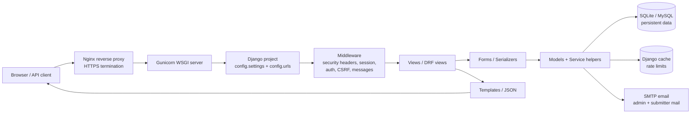
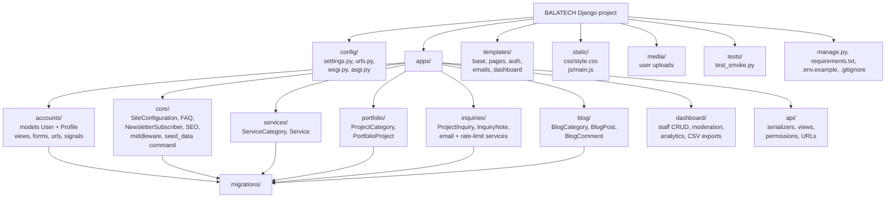
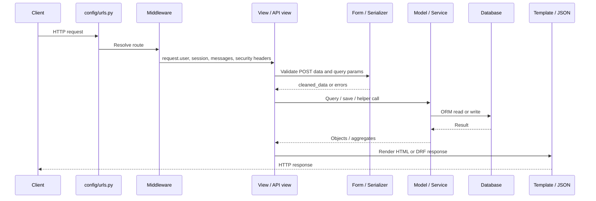
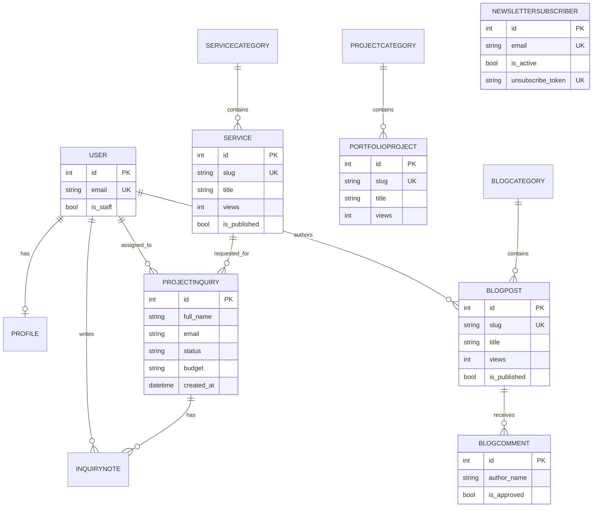
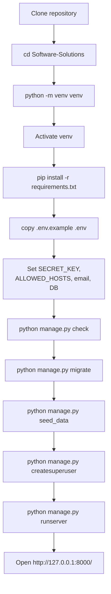
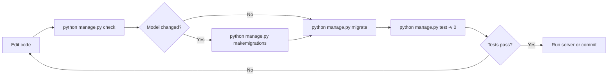
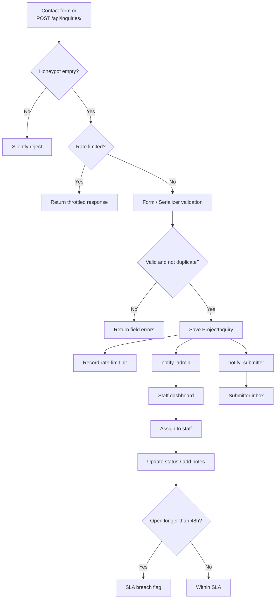
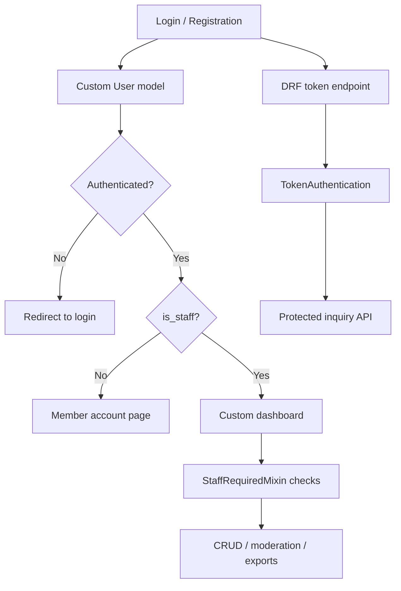
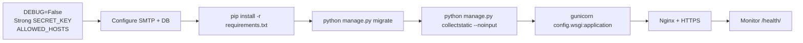

# BALATECH — Cloud & Software Development Solutions

A production-oriented Django web application for a software development services business. It includes a premium responsive frontend, dynamic service and portfolio modules, a technical blog, a full inquiry workflow with an admin dashboard, secure authentication, and a documented REST API.

## Features

- **Premium responsive frontend** — custom dark navy/blue design system, gradients, animations, mobile-first layouts, no Bootstrap.
- **Service management** — 4 primary services plus 8 supporting services, categories, features, technology stacks, benefits, dedicated detail pages, and admin editing.
- **Portfolio** — categories, filtering, screenshots, tech stacks, GitHub and live demo links, detail pages.
- **Contact & inquiries** — validated form with CSRF protection, duplicate-submission prevention, database persistence, optional SMTP notifications, statuses, internal notes, and spam deletion.
- **Authentication** — custom user model, registration, login/logout, password reset, member account area, staff-only dashboard.
- **Admin dashboard** — statistics, recent messages, inquiry pipeline, inquiry management, and full create/edit/delete CRUD for services, projects, and blog posts, plus profile settings.
- **Blog** — categories, search, publication dates, featured images, featured posts, publish/unpublish.
- **REST API** — services, portfolio, blog, and inquiries with pagination, filtering, search, validation, permissions, token authentication, and Swagger documentation via drf-spectacular.
- **SEO & abuse protection** — generated `robots.txt` and `sitemap.xml`, rate limiting on inquiry submissions, and a honeypot field on the contact form.
- **Global search** — keyword search across published services, projects, and articles at `/search/`.
- **FAQ section** — admin-managed FAQs with a native accordion on the homepage.
- **Enhanced admin** — CSV export of filtered inquiries and newsletter subscribers, a 7-day inquiry trend chart, blog comment moderation, and bulk status actions for inquiries.
- **Newsletter** — footer signup with honeypot, token-based unsubscribe links, and a dashboard subscriber list.
- **Blog comments** — moderated reader comments with spam filtering.
- **Inquiry auto-reply** — submitters receive a confirmation email when SMTP is configured.
- **Structured data** — JSON-LD for the organization, services, and blog posts; custom Django Admin branding.
- **Hardening** — security headers on every response and a `/health/` monitoring endpoint.
- **Analytics** — service/project/article view counts with a "Most viewed content" dashboard panel.
- **Inquiry workflow** — assign inquiries to staff and flag requests older than 48 hours as SLA breaches.
- **Theme toggle** — light/dark mode with `localStorage` persistence.
- **Security** — environment-based secrets, secure password hashing, CSRF/XSS/SQL-injection protections by framework, upload validation, permission checks, and production hardened settings.
- **Admin-editable content** — hero copy, about text, contact details, social links, statistics, technologies, and genuine testimonials.

## Technology Stack

| Layer | Technology |
| --- | --- |
| Language | Python 3.12 |
| Framework | Django 5.2 LTS |
| API | Django REST Framework, django-filter, drf-spectacular (OpenAPI/Swagger) |
| Database | SQLite (default), MySQL-ready via environment variables |
| Frontend | HTML5, custom CSS, vanilla JavaScript |
| Images | Pillow |
| Config | python-dotenv |

## Diagrams & Project Workflow

GitHub renders the Mermaid diagrams below natively.

### 1. Full system architecture



### 2. Complete folder structure flow



### 3. Backend request-handling sequence



### 4. URL routing map

```mermaid
flowchart LR
    ROOT[config/urls.py] --> PUB[Public<br/>/ , /about/, /services/,<br/>/portfolio/, /blog/, /contact/,<br/>/search/]
    ROOT --> ACC[/accounts/<br/>register, login, logout,<br/>password reset, account]
    ROOT --> DASH[/dashboard/<br/>staff only<br/>CRUD, moderation, exports]
    ROOT --> API[/api/<br/>services, portfolio, blog,<br/>inquiries, token, schema, docs]
    ROOT --> ADM[/admin/<br/>Django Admin]
    ROOT --> SYS[/robots.txt<br/>/sitemap.xml<br/>/health/]
    ROOT --> ERR[403 / 404 / 500 handlers]
```

### 5. Data model relationships



Standalone content models (no foreign-key relationships): `SiteConfiguration`, `Statistic`, `Technology`, `Testimonial`, `FAQ`, and `NewsletterSubscriber`.

### 6. Install and run workflow



### 7. Daily development loop



### 8. Inquiry end-to-end lifecycle



### 9. Authentication and permission flow



### 10. Deployment workflow



## Project Architecture

```
BALATECH_SOFTWARE_SOLUTIONS/
├── config/                 # Settings, root URLs, ASGI/WSGI
├── apps/
│   ├── accounts/           # Custom User, Profile, auth views, member account
│   ├── core/               # Site configuration, statistics, technologies, testimonials, seed command
│   ├── services/           # Service categories, services, public views
│   ├── portfolio/          # Project categories, projects, filtering
│   ├── inquiries/          # Inquiry form, notes, contact view
│   ├── blog/               # Blog categories, posts, search
│   ├── dashboard/          # Staff-only management dashboard
│   └── api/                # DRF serializers, views, URLs
├── templates/              # Reusable HTML templates (base + pages + dashboard)
├── static/                 # css/style.css, js/main.js
├── media/                  # User uploads (git-ignored)
├── tests/                  # Automated test suite
└── docs/                   # Additional documentation
```

## Installation

### 1. Prerequisites

- Python 3.10+ (tested with 3.12)
- Windows PowerShell (commands below are Windows-specific)
- Node.js is **not required** — the frontend uses vanilla CSS and JavaScript.

### 2. Create and activate the virtual environment

```powershell
cd "C:\Users\bmani\OneDrive\Desktop\BALATECH_SOFTWARE_SOLUTIONS"
python -m venv venv
.\venv\Scripts\Activate.ps1
```

If PowerShell blocks script execution, use:

```powershell
Set-ExecutionPolicy -Scope Process -ExecutionPolicy Bypass
.\venv\Scripts\Activate.ps1
```

Alternatively, call the interpreter directly: `.\venv\Scripts\python.exe`.

### 3. Install dependencies

```powershell
python -m pip install -r requirements.txt
```

### 4. Configure environment variables

```powershell
copy .env.example .env
```

Edit `.env` and set a strong `SECRET_KEY` before any production deployment. Never commit `.env`.

### 5. Database configuration

SQLite is used by default — no extra setup required.

To use MySQL:

1. Install the driver: `python -m pip install mysqlclient`
2. Create an empty database in MySQL.
3. Update `.env`:

```env
DB_ENGINE=mysql
DB_NAME=balatech
DB_USER=your_mysql_user
DB_PASSWORD=your_mysql_password
DB_HOST=localhost
DB_PORT=3306
```

Database credentials are read from environment variables and are never hardcoded.

### 6. Migrations and initial content

```powershell
python manage.py makemigrations
python manage.py migrate
python manage.py seed_data
```

`seed_data` is idempotent. It creates service/project/blog categories, technologies, services, and zero-valued editable statistics. Testimonials and portfolio projects are intentionally **not** seeded — add only genuine entries through Django Admin.

### 7. Create an administrator

```powershell
python manage.py createsuperuser
```

Staff status is required for the custom dashboard. To grant staff access to an existing user:

```powershell
python manage.py shell
```

```python
from apps.accounts.models import User
u = User.objects.get(username="your-user")
u.is_staff = True
u.save()
```

### 8. Run the development server

```powershell
python manage.py runserver
```

Open http://127.0.0.1:8000/

## Key Routes

| URL | Description |
| --- | --- |
| `/` | Home |
| `/about/` | About |
| `/services/` | Service list |
| `/services/<slug>/` | Service detail |
| `/portfolio/` | Portfolio with category filtering |
| `/portfolio/<slug>/` | Project detail |
| `/blog/` | Blog with search and category filtering |
| `/blog/<slug>/` | Article detail |
| `/contact/` | Project inquiry form |
| `/accounts/register/`, `/accounts/login/` | Authentication |
| `/accounts/account/` | Member account area |
| `/dashboard/` | Staff-only admin dashboard |
| `/admin/` | Django Admin |
| `/api/docs/` | Swagger UI |
| `/api/schema/` | OpenAPI schema (YAML by default; `?format=json` for JSON) |
| `/api/token/` | Obtain an API token (POST username/password) |
| `/robots.txt`, `/sitemap.xml` | SEO endpoints |
| `/search/` | Global site search |
| `/newsletter/subscribe/`, `/newsletter/unsubscribe/<token>/` | Newsletter signup and one-click unsubscribe |
| `/health/` | JSON health check for monitoring |

## REST API

Public read endpoints:

```
GET /api/services/
GET /api/services/<slug>/
GET /api/portfolio/
GET /api/portfolio/<slug>/
GET /api/blog/
GET /api/blog/<slug>/
POST /api/inquiries/
```

Protected endpoints (require a staff account — session, basic, or token auth):

```
GET /api/inquiries/list/
GET /api/inquiries/<id>/
PATCH /api/inquiries/<id>/
DELETE /api/inquiries/<id>/
```

Features: page-number pagination (10 items), `?category__slug=` filtering, `?search=` full-text search (blog/inquiries), ordering, validation, and appropriate HTTP status codes.

For basic auth with curl:

```powershell
curl -u admin:password http://127.0.0.1:8000/api/inquiries/list/
```

For token auth, obtain a token and send it as a header:

```powershell
curl -X POST -d "username=admin&password=your-password" http://127.0.0.1:8000/api/token/
curl -H "Authorization: Token YOUR_TOKEN" http://127.0.0.1:8000/api/inquiries/list/
```

## Testing

```powershell
python manage.py check
python manage.py makemigrations --check --dry-run
python manage.py test -v 2
```

The 57-test suite covers page loading, navigation, global search, service and portfolio pages, filtering, blog search, contact form validation, duplicate prevention, rate limiting, honeypot rejection, CSRF enforcement, security headers, health checks, database creation, admin and submitter email notifications, FAQs, registration/login/logout, staff authorization, dashboard CRUD actions, CSV exports, trend analytics, view tracking, newsletter signup/unsubscribe, blog comment moderation, inquiry assignment and SLA flags, token authentication, admin bulk actions, REST API endpoints, permissions, Swagger documentation, JSON-LD, and SEO endpoints.

## Email Notifications

Inquiries from both the contact form and the REST API are always saved to the database. Email notifications are sent only when SMTP is configured:

```env
EMAIL_BACKEND=django.core.mail.backends.smtp.EmailBackend
EMAIL_HOST=smtp.example.com
EMAIL_PORT=587
EMAIL_HOST_USER=your-user
EMAIL_HOST_PASSWORD=your-password
EMAIL_USE_TLS=True
CONTACT_EMAIL=hello@yourdomain.com
```

In development, the console backend prints emails to the terminal.

## Production Deployment Preparation

1. Set `DEBUG=False` and a strong random `SECRET_KEY` in `.env`.
2. Set `ALLOWED_HOSTS` to your domain(s), comma-separated.
3. Configure SMTP and `CONTACT_EMAIL`.
4. Use a production database (MySQL/PostgreSQL) via environment variables and install the corresponding driver.
5. Run:

```powershell
python manage.py check --deploy
python manage.py collectstatic --noinput
python manage.py migrate
```

6. Serve with a production WSGI/ASGI server (for example `gunicorn config.wsgi:application` behind nginx) and serve `staticfiles/` and `media/` through the web server or a CDN.
7. Enable HTTPS; the application automatically enables secure cookies, HSTS, SSL redirect, and hardened headers when `DEBUG=False`.
8. Keep `.env`, `db.sqlite3`, and `media/` out of version control.

## Security Notes

- Secret key and database credentials come from `.env`.
- Django's CSRF middleware protects all POST requests.
- Template autoescaping and DRF serializers prevent XSS/injection issues; ORM queries prevent SQL injection.
- Passwords are hashed using Django's PBKDF2 hasher and validated against common-password rules.
- Image uploads are size- and extension-validated.
- Staff-only views use both login and staff permission checks; protected APIs use DRF permissions.

## Maintenance

- Update site copy, statistics, technologies, and genuine testimonials in `/admin/`.
- Publish/unpublish services, projects, and posts from `/dashboard/` or Django Admin.
- Review and respond to inquiries in `/dashboard/inquiries/`.
